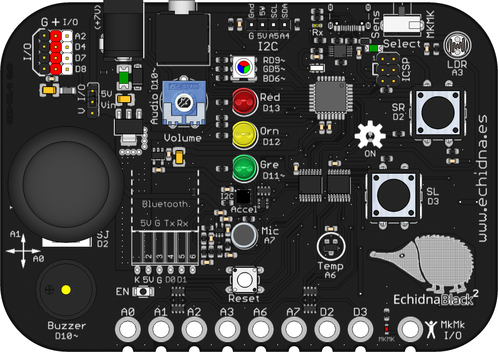
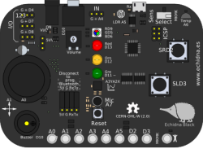
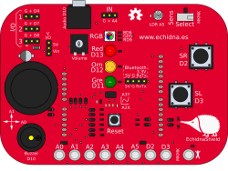
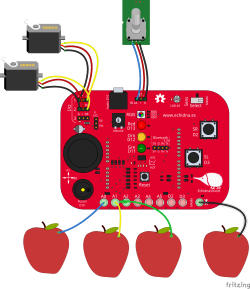
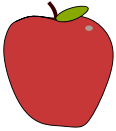

# Componentes de Fritzing

[Fritzing](https://fritzing.org) es un programa libre para diseñar circuitos electrónicos. Permite
dibujar un montaje en la **vista protoboard** (tal y como se vería en la mesa), y a partir de él
obtener el **esquema** eléctrico y el diseño de la **PCB**. Es muy útil para preparar imágenes de
conexión para el manual, las actividades y el material de clase.

En esta carpeta están los componentes de Fritzing de las placas de Echidna y de algunos elementos que
se usan en las actividades (por ejemplo, la manzana o la mano para el modo MkMk), listos para
importar.

## Conseguir Fritzing

- **Descarga oficial**: [fritzing.org/download](https://fritzing.org/download). Hay versiones para
  Windows, macOS y Linux. Los instaladores se obtienen haciendo una pequeña aportación económica
  al proyecto, que es lo que financia su desarrollo.
- **Código fuente**: Fritzing sigue siendo software libre; el código está en
  [github.com/fritzing/fritzing-app](https://github.com/fritzing/fritzing-app) y algunas
  distribuciones de Linux lo incluyen en sus repositorios (por ejemplo,
  `sudo apt install fritzing` en Debian/Ubuntu), aunque suele ser una versión más antigua.

## Importar un componente

Cada componente es un archivo `.fzpz`, que contiene el componente con sus vistas de protoboard, esquema y PCB.

1. Descarga el archivo `.fzpz` del componente (en GitHub, abre el archivo y pulsa el botón de descarga).
2. Abre Fritzing y ve a la vista **Protoboard**.
3. En el panel **Componentes**, abre el menú del contenedor (el icono situado junto al buscador) y elige
   **Importar…**. Selecciona el archivo `.fzpz`.
   - También puedes abrirlo directamente con **Archivo → Abrir…**.
4. El componente aparece en el contenedor **MINE** (mis componentes). Desde ahí se arrastra al área de trabajo
   como cualquier otro.

El componente queda guardado en Fritzing para siempre, así que solo hay que importarlo una vez. Además,
cuando guardas un proyecto (`.fzz`) los componentes que usa van incluidos en él: quien lo abra no
necesita importarlos.

## Recursos

Para cada componente hay tres archivos: el componente para Fritzing (`.fzpz`), la imagen vectorial de la
vista protoboard (`.svg`) y una imagen de previsualización (`.png`).

### EchidnaBlack2

- [Componente de Fritzing](echidnablack2/echidnablack2.fzpz)
- [Imagen vectorial SVG](echidnablack2/fritzing-echidnablack2.svg)

### Echidna Black

- [Componente de Fritzing](echidnablack/echidnablack.fzpz)
- [Imagen vectorial SVG](echidnablack/fritzing-echidnablack.svg)

### EchidnaShield

- [Componente de Fritzing](echidnashield/echidnashield.fzpz)
- [Imagen vectorial SVG](echidnashield/fritzing-echidnashield.svg)
- Esquema: [PNG](echidnashield/esquema-echidnashield.png) · [SVG](echidnashield/esquema-echidnashield.svg)

### Manzana

- [Componente de Fritzing](manzana/manzana.fzpz)
- [Imagen vectorial SVG](manzana/fritzing-manzana.svg)

### Mano

- [Componente de Fritzing](mano/mano.fzpz)
- [Imagen vectorial SVG](mano/fritzing-mano.svg)

## Autoría y licencia

- Autoría: [Echidna Educación](https://echidna.es)
- Licencia: [Creative Commons Atribución-CompartirIgual 4.0 (CC BY-SA 4.0)](https://creativecommons.org/licenses/by-sa/4.0/deed.es)
